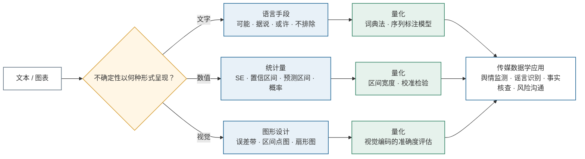
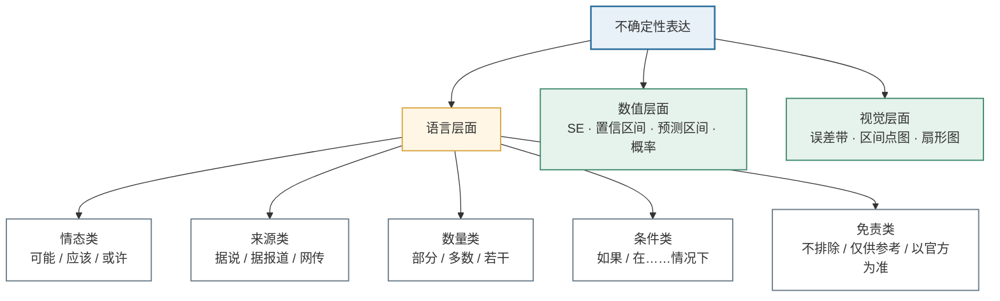
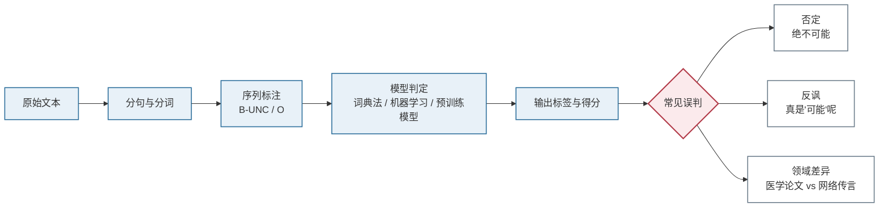

# 不确定性表达

- **姓名**：刘玉洁
- **学号**：202513093070
- **课程**：传媒数据学
- **认领词条**：不确定性表达

---

## 一、定义

**不确定性表达**（uncertainty expression / uncertainty communication），指**将数据、测量、模型与预测的局限，以文字、数值和视觉形式传达**的一整套表达实践。它回答的问题是：某个结论"有多大把握、边界在哪里、可能错在哪"。具体包括三个层面：

1. **数值层面**：标准误、置信区间、预测区间、概率及其校准程度；
2. **语言层面**：模糊限制语（hedging）与认识情态表达，即说话者表示自己对命题真假、信息来源可靠程度或推断强度**没有十足把握**的语言手段；
3. **视觉层面**：误差带、区间点图、扇形图等把不确定性画出来的图形设计。

用一句话概括：**不确定性表达就是"我对这件事有多确定"在文字、数字和图形上的显性呈现。**

需要特别强调：**语言层面的 hedging 只是不确定性表达的一个子集，而不是全部**。一篇新闻报道可以不含任何模糊限制语，却通过"误差 ±3 个百分点"的数值传达不确定性；反之，一句满是"可能""据说"的话，如果没有数值支撑，也无法告诉读者把握到底有多大。在传媒数据学中，该词条包含一层计算含义：把文本与图表中的不确定性表达识别出来，并转化为可以统计、比较和建模的**不确定性特征**。若只考察语言层面，可用词典法给出一个最简形式（注意：它度量的是**语言上的保留密度**，不能直接等同于数值意义上的概率或置信度，二者不可互换）：

$$
U(d)=\frac{1}{N}\sum_{i=1}^{N} w_i \cdot \mathbb{I}(t_i \in L_u)
$$

其中 $N$ 为文本词数，$t_i$ 为第 $i$ 个词，$L_u$ 为不确定性词表，$w_i$ 为词权重，$\mathbb{I}(\cdot)$ 为指示函数（条件成立取 $1$，否则取 $0$）。$U(d)$ 越大，表示文本整体越倾向于保留、犹豫或弱断言。

## 二、背景和上下文

### 2.1 语言学与统计学两条脉络

不确定性表达的研究沿两条脉络发展。语言学脉络可追溯到 Lakoff 于 1972 年提出、1973 年正式发表的"hedges"概念，此后在学术写作、语篇分析和情态研究中不断发展。Hyland 对学术论文的研究发现，研究者常用 *may*、*suggest*、*to some extent* 等表达来避免绝对化，从而为结论留下被修正的空间。这类表达并非"说话没水平"，而是一种成熟的**语用策略**。

另一条是统计学与风险沟通脉络：抽样调查的误差幅度、统计推断中的区间估计、气象预报的概率表达，以及数据新闻中的误差可视化，都研究"如何把数值不确定性讲清楚、画明白"。传媒数据学的不确定性表达同时继承这两条脉络——**语言层面的 hedging 是其中一节，而非全部**。

### 2.2 传媒与传播学背景

新闻传播场景中，不确定性表达尤其常见，因为它同时承担三种功能：

1. **认识功能**：如实反映信息的不完整，如"据初步调查"。
2. **修辞与社交功能**：缓和语气、避免冒犯，如"这可能只是我的个人看法"。
3. **责任规避功能**：在信息未经完全核实的情况下留出回旋余地，如"不排除……的可能"。

在**舆情监测、谣言识别、事实核查、风险沟通、健康传播**等场景中，不确定性表达是一个关键信号：它既可能是专业审慎的体现，也可能被用来包装未经证实的信息。

### 2.3 传媒数据学中的位置

传媒数据学关注"用数据方法研究传媒现象"。不确定性表达因此从语言现象转化为**文本特征**，进入以下任务：

- 情感分析与立场分析：区分"我支持"与"我可能支持"；
- 舆情预警：统计某话题中不确定性表达的占比变化；
- 虚假信息检测：识别"据说""网传""不排除"等高风险话语标记；
- 生成式人工智能内容检测：判断模型输出是否进行了恰当的置信度表达。

## 三、举例说明

### 3.1 新闻文本

> 据知情人士透露，该公司**可能**于下半年启动重组，具体方案**尚未确定**。

- "据知情人士透露"：信息来源不确定；
- "可能"：事件发生概率不确定；
- "尚未确定"：事件状态本身不确定。

### 3.2 社交媒体文本

> 听说这次考试要改革？应该不会吧，我也不太确定。

"听说""应该""不太确定"层层叠加，使整句话的断言强度显著降低。若用情感分析模型只看"不会"，可能误判为确定否定；只有结合不确定性表达，才能读出说话者的犹豫。

### 3.3 学术与研究文本

> 结果**在一定程度上**支持了原假设，但样本量有限，因果关系**仍有待进一步检验**。

这里的不确定性表达是学术规范的一部分，用于界定结论的适用边界。

### 3.4 数值型不确定性：从抽样误差到预测误差

传媒报道中引用的每一个数字背后，几乎都存在测量与推断的局限。主要有四类统计概念：

1. **标准误**（standard error, $\mathrm{SE}$）：样本统计量（如均值）因抽样而波动的程度。例：民调报道"支持率 48%（$\mathrm{SE}=2\%$）"，意味着若重复抽样，样本支持率大致围绕真值波动。

2. **置信区间**（confidence interval, CI）：由样本构造出的一个范围，其频率派含义是"若重复抽样并按同一方法构造区间，约有 95% 的区间会覆盖真值"。例："支持率的 95% 置信区间为 [44%, 52%]"——新闻中常写作"误差幅度 ±4 个百分点"。注意它刻画的是**估计的不确定性**，而非"真参数有 95% 的概率落在这个区间里"（这是常见的频率派/贝叶斯混读）。

3. **预测区间**（prediction interval）：对未来单个观测值的范围，通常比置信区间宽，因为它同时包含**估计误差**和**个体随机波动**。例："预计下周票房 3 亿元，预测区间 [2.4, 3.6] 亿元"。媒体报道常把两者混用，造成"预测失准"的错觉。

4. **概率校准**（calibration）：一个声称"70% 把握"的模型或专家，其预测在长期中应约有 70% 成真；否则就是过度自信或过度保守。校准是评估预测者质量的关键指标。

除统计概念外，还有一类**来源局限**：数据是哪里来的、覆盖谁、缺什么。抽样框不全、应答率低、信源单一，都会使上述数值即使算对了也代表性不足。另需注意，"据报道""据知情人士"属于**语言层面的来源标记**——它告诉读者信息出自何处，但本身**不携带固定数值的事实置信度**（详见 6.2 的讨论）。

### 3.5 视觉型不确定性：把误差画出来

数据新闻中，不确定性主要通过图形传达，两种最常见的形式：

- **误差带**（error band / ribbon）：在时间序列折线图上，用一条半透明带子包住预测线，表示预测区间。例如疫情报道中"未来两周新增病例预测"的扇形展开区域——越往未来，带子越宽，表示越不确定。
- **区间点图**（interval dot plot / error bar）：用一个点表示点估计，一条线段表示置信区间。例如选举民调聚合图中，每位候选人支持率一个点、一条 ±误差线；若两条线段重叠，读者即可直观判断"差距可能在误差范围内"。

这类"数值型不确定性"与"语言型不确定性"在传媒数据学中经常需要联合分析：一段"预计可能增长"的文字配上"预测区间 [2.4, 3.6]"的图，才构成完整的表达。

**常见语言手段对照表：**

| 类型 | 典型词语 | 作用 |
| --- | --- | --- |
| 情态动词 | 可能、或许、应该、可以 | 表示可能性或义务强度 |
| 模糊限制语 | 似乎、大概、据说、据报道 | 弱化断言或标明来源 |
| 数量模糊 | 部分、某些、若干、多数 | 回避精确数量 |
| 条件句 | 如果、假如、在……情况下 | 限定结论成立条件 |
| 免责声明 | 不排除、仅供参考、以官方为准 | 降低承诺与责任 |
| 数值表达 | 置信区间、标准误、概率 | 量化不确定性 |

## 四、对比分析

### 4.1 与确定性表达的区别

确定性表达如"一定""必然""已经证实""毫无疑问"，其断言强度高；不确定性表达则降低断言强度。二者构成**断言强度连续统**，可写为：

$$
\text{确定} \;>\; \text{较确定} \;>\; \text{可能} \;>\; \text{不确定}
$$

在计算建模中，这通常被映射为 $[0,1]$ 区间上的置信度，例如：

$$
c(t)=\sigma(z)=\frac{1}{1+e^{-z}}
$$

其中 $z$ 为模型给出的证据得分，$c(t)$ 越接近 $1$ 表示模型越确定。注意：这是**模型自报的置信度**，与事实为真的概率是两回事——模型可以满怀信心地出错，其置信度是否可信需经校准检验（见 5.6 的 ECE）。

### 4.2 与模糊表达的区别

**模糊**（vagueness）指词语边界不清晰，例如"年轻人"到底指几岁到几岁；**不确定性**指说话者对命题真假缺乏把握，例如"他可能是年轻人"。前者是**语义边界问题**，后者是**认识态度问题**。用模糊集合可以刻画前者：

$$
\mu_A(x)\in[0,1]
$$

表示元素 $x$ 属于集合 $A$ 的程度，而不是"是或不是"的二值判断。

### 4.3 与歧义、虚假信息的区别

- **歧义**（ambiguity）：一个表达存在多种解释，如"咬死了猎人的狗"；
- **不确定性表达**：说话者承认自己不确定；
- **虚假信息**：内容与事实不符，可能被表达得很确定，也可能用不确定性表达作掩护。

因此，**"用了不确定性词"不等于"信息一定不可靠"**，必须结合语境、来源与事实核查综合判断。

### 4.4 与情感表达的区别

情感分析关注**评价倾向**（正面/负面），不确定性表达关注**认识态度**（确定/不确定）。例如"这可能是好事"包含正面情感，同时具有明显的不确定性。两套特征需要分别建模，也可组合使用。

## 五、深入扩展：不确定性的类型、度量与算法

### 5.1 不确定性类型

1. **认识不确定性**（epistemic uncertainty）：知识不足导致，如"我们尚不清楚原因"；
2. **偶然不确定性**（aleatory uncertainty）：事件本身随机，如"明天下雨的概率为 $60\%$"；
3. **模型不确定性**（model uncertainty）：模型设定或参数不唯一导致；
4. **语用不确定性**：出于礼貌、修辞或责任规避而刻意保留余地。

需要说明：这一四分法与第一节的"文字 / 数值 / 视觉"三层面是两个不同的维度——**类型回答"不确定从哪来"，层面回答"不确定怎么表达"**。例如认识不确定性既可以体现在语言上（"尚不清楚"），也可以体现在数值上（参数的置信区间）；语用不确定性则主要体现在语言层面。后文的度量方法分别对应不同类型：5.2 的词典法捕捉语言层面的各类保留（含语用性保留），5.3 的信息熵度量群体意见分布的分散，5.4 的贝叶斯更新刻画认识不确定性随证据的演变。

### 5.2 度量方法一：词典与规则法

词典法将文本切分为词序列后，统计不确定性词命中情况，即前文的 $U(d)$。其优点是透明、可解释，缺点是难以处理否定、反讽和语境。例如"绝不可能"字面命中"可能"，但语义是高确定性否定；若直接用"否定词窗口内扣分"的修正（如 $U'(d)=U(d)-\lambda \cdot U_{\text{neg}}(d)$，其中 $U_{\text{neg}}(d)$ 为落在否定词邻域内的命中得分），"绝不可能"反而被扣成更"确定"，与 6.6 列出的否定误判对照即可见：**此类规则修正在否定语义上恰恰方向失灵，需要依赖句法角色与辖域分析，或直接交给序列标注模型（5.5）学习**。词典法更稳妥的定位是粗粒度描述性指标，而非精确的不确定性度量。

### 5.3 度量方法二：概率与信息熵（及其解释边界）

若把某话题下文本的立场分布记为 $p$，则该分布的信息熵为：

$$
H(X)=-\sum_{i=1}^{n} p(x_i)\log_2 p(x_i)
$$

当支持与反对各占 $50\%$ 时，二值熵取最大值：

$$
H_{\max}=-\left(\frac{1}{2}\log_2\frac{1}{2}+\frac{1}{2}\log_2\frac{1}{2}\right)=1 \text{ bit}
$$

**使用时必须明确解释边界**：熵**仅描述立场分布的分散程度**（意见分化度），它不是事实不确定性的度量，也不能用于预测事件反转。三点关键澄清：

1. **支持反对各半 ≠ 事实真假未定，更不推出"更易反转"**。50/50 只说明两类意见在样本中比例均衡；事件可能早已被证据清楚判定，只是舆论尚未收敛。从"熵高"推出"事件更可能反转"没有任何证据支持——熵不携带关于事件真相或未来走向的信息。
2. **意见一致 ≠ 事实正确**。$p=1$、熵为零时，只能说样本内意见完全一致；公众可能集体相信一个错误结论（如谣言的一致传播）。熵低不构成对事实的任何验证。
3. **熵的正当用途**：作为舆情监测中的**描述性指标**，报告立场分布的集中/分散状态及其随时间的变化。若要研究事件走向，需另行引入证据链、信源可信度等特征并建立专门模型，熵本身不承担这一任务。

四个容易混淆的对象在此一并划清：**语言保留**（5.2 的词典密度 $U(d)$，个体文本的语言特征）、**意见分化**（本节的信息熵，群体立场分布特征）、**模型概率**（5.5/5.6 的分类与校准概率，模型自报的把握）、**事实可靠性**（需要事实核查独立判定，任何上述指标都不能替代）。四者互不推导：词典密度高不等于意见分化，意见分化不等于事实可疑，模型概率高不等于结论正确。

### 5.4 度量方法三：贝叶斯更新（不必然降低不确定性）

不确定性会随新证据而改变。设 $H$ 为假设，$E$ 为新证据，则：

$$
P(H \mid E)=\frac{P(E \mid H)\,P(H)}{P(E)}
$$

$P(H)$ 是先验概率，$P(H \mid E)$ 是后验概率。需要注意：**新证据不必然使后验分布更集中**。只有在证据与假设强相关且各假设对证据的预测充分可区分（即似然比明显偏离 1）时，后验才会向某一假设集中；若证据是模糊的、多义的——同一证据在多个假设下都可能出现——后验分布可能几乎不变，甚至因引入新的竞争假设而**变得更加分散**。此外，若证据本身有偏（如选择性披露的信源），"更新"还可能系统性地把信念推向错误方向。

因此，对"舆情反转"更准确的表述是：**新证据改变了公众对事件为真的信念分布**——可能使其更集中（收敛），也可能使其更分散（进一步撕裂），方向取决于证据的区分度与可信度，而非贝叶斯机制本身。

### 5.5 自动识别流程与评价

一个典型的不确定性表达识别流程为：

> 文本获取 → 分词与句法分析 → 特征抽取 → 序列标注/分类模型 → 输出不确定性标签

标签体系常采用 BIO 形式，例如"可能"被标注为 `B-UNC`、"应该"为 `B-UNC`，非不确定性词为 `O`。模型方面，早期多使用 SVM、CRF 等方法，如今多使用 BERT 等预训练语言模型。分类概率常由 softmax 给出：

$$
P(y=k \mid x)=\frac{\exp(z_k)}{\sum_{j=1}^{K}\exp(z_j)}
$$

评价指标包括精确率 $P$、召回率 $R$、$F_1$ 值：

$$
F_1=2\cdot\frac{P\cdot R}{P+R}
$$

人工标注的一致性可用 Cohen's $\kappa$ 衡量：

$$
\kappa=\frac{p_o-p_e}{1-p_e}
$$

其中 $p_o$ 为观察一致率，$p_e$ 为随机一致率。按照 Landis 与 Koch 提出的经验标准（Landis & Koch, 1977），$\kappa$ 在 $0.81\sim1.00$ 表示几乎完全一致，$0.61\sim0.80$ 表示高度一致，低于 $0.40$ 则说明标注标准需要重新界定。

### 5.6 主要挑战

- **语境依赖**："可能"有时表示不确定，有时只是客气；
- **否定与反讽**："绝不可能"含有"可能"，但表达的是高确定性；
- **领域差异**：医学论文中的 hedging 与网络传言中的 hedging 功能不同；
- **标注主观性**：不同标注者对"不确定程度"的判断可能不一致；
- **模型校准**：模型输出的高概率不一定代表真实可信，可用期望校准误差衡量：

$$
\mathrm{ECE}=\sum_{m=1}^{M}\frac{|B_m|}{n}\left|\mathrm{acc}(B_m)-\mathrm{conf}(B_m)\right|
$$

## 六、可视化理解

> 本节所有图形均使用 **GitHub 原生支持**的格式：Mermaid 流程图、表格与文本图，**无需任何外部图片文件**，粘贴到 GitHub 后可直接渲染。

### 6.1 总览：从表达形式到数据特征

不确定性表达研究要回答的是一条完整链路：文本与图表中**有没有**不确定性标记、**属于哪个层面**、**程度多高**，以及最终**能用来做什么分析**。



**一句话读图**：同一种"把握程度"可以走三条路呈现——文字、数值、视觉；三条路各有自己的量化方法，最终汇入传媒数据学的应用环节。

### 6.2 断言强度标尺

不确定性表达并不只有"有或没有"，而是一条从"完全确定"到"完全不确定"的连续刻度：

```text
确定 ←──────────────────────────────────────────────────────────→ 不确定

 一定      已经证实     多数情况下      可能/或许      据说/网传     不排除/尚无定论
  │           │             │              │              │              │
（断言强）                                                              （断言弱）
```

| 刻度 | 典型表达 | 表达功能 | 传播含义 |
| --- | --- | --- | --- |
| 强断言 | 一定、必然、已经证实 | 直接承担真值责任 | 信息被当作事实传播，责任最重 |
| 较强断言 | 多数情况下、基本可以确认 | 留有小幅修正空间 | 结论有明确边界 |
| 弱断言 | 可能、或许、倾向于认为 | 承认存在其他可能 | 把握程度被明示 |
| 来源标记 | 据说、网传、据报道 | **标明信息出处，转移举证责任** | 读者需自行评估该来源的可信度 |
| 高度不确定 | 不排除、尚无定论、有待核实 | 明确表示结论未定 | 信息仍处核查阶段 |

**两点必须澄清**：

1. **"据报道"是来源标记，不能固定映射为某个事实置信度**。像 0.2—0.4 这样的数值映射是不成立的：同是"据报道"，官方通稿与匿名营销号的可靠度天差地别；某些高可信来源的报道几乎相当于直接证实。来源标记传达的是"责任归属"信息——谁说的、谁负责——其对应的事实置信度只能通过**对该信源历史表现的统计评估**（如信源级的事实核查记录、校准分析）获得，而不是由词语本身决定。
2. **断言强度与事实置信度是两个维度**。说话者可以斩钉截铁地说错话，也可以诚实地表示不确定而结论恰好正确。标尺上位置越靠"确定"，只说明说话者**承诺越强**，不代表事实为真的概率越高。若研究需要数值化，应通过带标注数据的模型（配合 5.5 的校准评估）学习，而非人工给词语赋固定分值。

### 6.3 不确定性表达的类型地图

不确定性表达并非零散的几个词，先按第一节的三个层面分域，语言层面之下再细分五类：



**一句话读图**：数值层面和视觉层面是**表达形式**的区分，语言层面内部的五类是**语言手段**的区分，二者不在同一层级；同一份报道可以同时使用三个层面的表达（如"可能增长"＋"预测区间 [2.4, 3.6]"＋误差带图）。

### 6.4 量化示例：一句话的不确定性得分

按前文词典法公式 $U(d)=\frac{1}{N}\sum_{i=1}^{N} w_i \cdot \mathbb{I}(t_i \in L_u)$，设不确定性词表 $L_u$ 及权重为：可能 $=1.0$、网传 $=1.0$、据……透露（作为一个多词词表项，匹配时合并计数为 $1$）$=1.0$，其余词为 $0$。四个例句的示意性切分与计算如下（不计标点）：

| 例句 | 切分结果 | 词数 $N$ | 命中项 | 加权命中 $U_{\text{raw}}$ | $U(d)$ |
| --- | --- | --- | --- | --- | --- |
| 公司可能启动重组 | 公司/可能/启动/重组 | 4 | 可能（1.0） | 1.0 | 0.250 |
| 据知情人士透露，公司可能于下半年启动重组 | [据…透露]（1）/公司/可能/于/下半年/启动/重组 | 7 | [据…透露]（1.0）、可能（1.0） | 2.0 | 0.286 |
| 网传该公司将于下半年启动重组 | 网传/该/公司/将/于/下半年/启动/重组 | 8 | 网传（1.0） | 1.0 | 0.125 |
| 该公司将于下半年启动重组 | 该/公司/将/于/下半年/启动/重组 | 7 | 无 | 0.0 | 0.000 |

```text
U(d)
0.286 | ██████████████████████  据知情人士透露，公司可能于下半年启动重组
0.250 | ████████████████████    公司可能启动重组
0.125 | ██████████              网传该公司将于下半年启动重组
0.000 |                         该公司将于下半年启动重组
      +---------------------→
```

可以看到：第二句命中两个不确定性表达，归一化后得分最高；而两句长度相近、命中项更少时得分更低。这提示我们：**$U_{\text{raw}}$ 反映"不确定性表达的绝对数量"，$U(d)$ 反映"不确定性表达的相对密度"，两者应结合报告**；且多词词表项（如"据……透露"）的匹配方式会直接影响结果，使用时必须事先写明匹配规则。

### 6.5 信息熵：意见分化度的可视化

设某话题被支持的概率为 $p$，则二值情形下的信息熵为：

$$
H(p)=-\left[p\log_2 p+(1-p)\log_2(1-p)\right]
$$

| 支持概率 $p$ | 反对概率 $1-p$ | 信息熵 $H(p)$ / bit | 意见分布状态 |
| --- | --- | --- | --- |
| 0.50 | 0.50 | 1.000 | 意见完全分化 |
| 0.60 | 0.40 | 0.971 | 高度分化 |
| 0.70 | 0.30 | 0.881 | 明显分化 |
| 0.80 | 0.20 | 0.722 | 意见开始集中 |
| 0.90 | 0.10 | 0.469 | 意见高度集中 |
| 1.00 | 0.00 | 0.000 | 意见完全一致 |

```text
H(p) / bit
1.00 |              ●
     |            ●   ●
0.75 |          ●       ●
     |        ●           ●
0.50 |      ●               ●
     |    ●                   ●
0.25 |  ●                       ●
     |●                           ●
0.00 +--------------------------------●
     0    0.25    0.50    0.75    1.00   p
```

曲线在 $p=0.5$ 处最高（$H=1$ bit），向两端递减。在舆情分析中，$H(p)$ 仅作为**意见分化度的描述性指标**：它报告立场分布的集中或分散状态，仅此而已。**熵高不意味着事件真假未定，不预示反转；熵为零只说明意见一致，不等于结论正确**——不要从这条曲线上读出任何关于事件真相或未来走向的推断。

### 6.6 识别流程与常见误判

不确定性表达的自动识别是一条标准流水线，但每一环都可能被语境"骗"到：



**文字版流程**：原始文本 → 分句分词 → 序列标注（B-UNC / O）→ 模型判定 → 输出标签与得分，再进入"常见误判"检查。

| 易错类型 | 例子 | 表层特征 | 真实含义 |
| --- | --- | --- | --- |
| 否定 | 绝不可能发生 | 含"可能" | 高确定性否定 |
| 反讽 | 他"可能"会来吧（嘲讽语气） | 含"可能" | 实际表达怀疑或否定 |
| 双层不确定 | 我不确定他是否会来 | 含"不确定" | 指向说话者自身状态，而非事件概率 |
| 领域差异 | 本研究结果提示…… | 学术 hedging | 学术规范，不等于信息不可靠 |

**一句话看懂本节**：不确定性表达是一条**刻度**（6.2）、一个**谱系**（6.3）、一个**可计算的分数**（6.4）、一条**熵曲线**（6.5），也是一张**容易踩坑的识别流程图**（6.1 / 6.6）。

## 七、在传媒数据学中的应用场景

1. **舆情监测**：追踪话题中不确定性表达的比例变化，作为舆论信息环境的描述性指标（至于舆论是否"未定"，需结合立场分布与证据链等多重特征综合判断）；
2. **谣言与虚假信息检测**：将"网传""据说""不排除"等话语标记纳入特征体系；
3. **事实核查与新闻质量评估**：区分"证实"与"可能"，评估报道的严谨程度；
4. **风险与健康传播**：在不确定情境下，恰当的不确定性表达有助于维持公众信任；
5. **生成式人工智能治理**：检测大语言模型是否存在"过度自信"或"幻觉性断言"；
6. **推荐与用户研究**：分析用户评论中的犹豫表达，理解其决策心理。

## 八、简明总结

- **是什么**：不确定性表达是将数据、测量、模型与预测的局限，以文字（hedging）、数值（标准误、置信区间、预测区间、概率校准）和视觉（误差带、区间点图）形式传达的表达实践；语言 hedging 只是其中一个层面。
- **为什么重要**：它影响信息可信度、舆论走向与传播责任，是传媒数据学中的重要文本与视觉特征。
- **怎么用**：语言层面用词典密度、序列标注模型度量；数值层面用区间与校准评估；群体层面用信息熵描述立场分布——语言保留、意见分化、模型概率、事实可靠性四个对象互不替代，且前三个都不能替代事实核查。
- **关键区分**：不确定性表达不同于模糊、歧义和虚假信息；意见熵度量意见分布而非事实真假；"据报道"是来源标记而非固定置信度；新证据经贝叶斯更新也不必然降低不确定性。
- **一句话记忆**：**不确定性表达是"把握程度"在文字、数字和图形上的显性呈现，而传媒数据学的任务，是把这个把握程度读出来、量出来、校准后再用起来。**

## 参考文献（延伸阅读）

1. Lakoff, G. (1973). Hedges: A study in meaning criteria and the logic of fuzzy concepts. *Journal of Philosophical Logic*, 2(4), 458–508. https://doi.org/10.1007/BF00262952 （"hedges"概念最早见于 1972 年芝加哥语言学会会议论文）
2. Hyland, K. (1998). *Hedging in Scientific Research Articles* (Pragmatics & Beyond New Series 54). John Benjamins. https://doi.org/10.1075/pbns.54
3. Palmer, F. R. (2001). *Mood and Modality* (2nd ed.). Cambridge University Press. https://doi.org/10.1017/CBO9781139167178
4. Shannon, C. E. (1948). A mathematical theory of communication. *Bell System Technical Journal*, 27(3), 379–423. https://doi.org/10.1002/j.1538-7305.1948.tb01338.x
5. Cohen, J. (1960). A coefficient of agreement for nominal scales. *Educational and Psychological Measurement*, 20(1), 37–46. https://doi.org/10.1177/001316446002000104
6. Landis, J. R., & Koch, G. G. (1977). The measurement of observer agreement for categorical data. *Biometrics*, 33(1), 159–174. https://doi.org/10.2307/2529310
7. Jurafsky, D., & Martin, J. H. (2009). *Speech and Language Processing* (2nd ed.). Pearson Prentice Hall. （第 3 版草稿见 https://web.stanford.edu/~jurafsky/slp3/）
8. DeGroot, M. H., & Fienberg, S. E. (1983). The comparison and evaluation of forecasters. *Journal of the Royal Statistical Society: Series D (The Statistician)*, 32(1–2), 12–22. https://doi.org/10.2307/2987588 （概率校准与"精炼度"概念的开创性讨论）
9. Hullman, J., Qiao, X., Correll, M., Kale, A., & Kay, M. (2019). In pursuit of error: A survey of uncertainty visualization evaluation. *IEEE Transactions on Visualization and Computer Graphics*, 25(1), 903–913. https://doi.org/10.1109/TVCG.2018.2864889 （不确定性可视化评估综述，含误差带与区间图）
10. Gigerenzer, G., Gaissmaier, W., Kurz-Milcke, E., Schwartz, L. M., & Woloshin, S. (2007). Helping doctors and patients make sense of health statistics. *Psychological Science in the Public Interest*, 8(2), 53–96. https://doi.org/10.1111/j.1539-6053.2008.00033.x （面向公众的不确定性/风险沟通）

